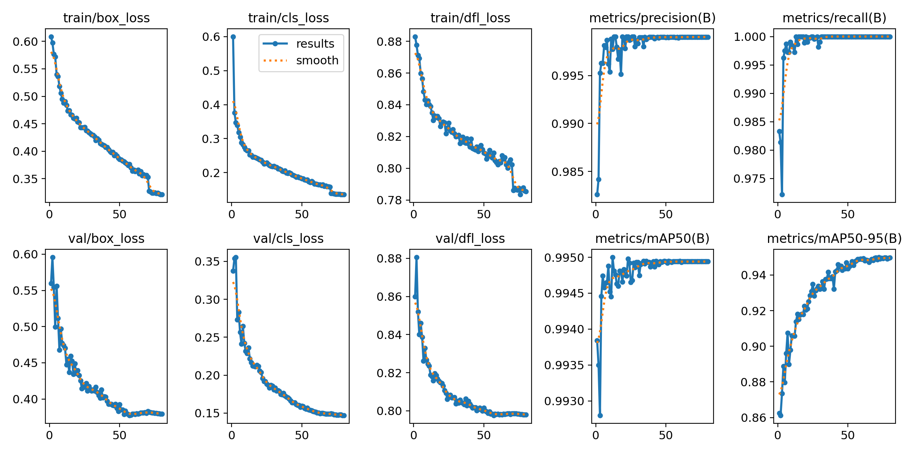

# Experimental YOLOv8 BlueROV2 Detector

This directory documents an earlier deep-learning perception approach explored during the development of the BlueROV2 visual-following project.

A YOLOv8s object detector was fine-tuned to detect the `BlueROV2` vehicle and evaluated on recorded simulation footage, including footage rendered in Unreal Engine.

The final demonstrated visual-following system later evolved toward LED-specific OpenCV perception, but this experiment contributed to the image-space target representation used in later stages of the project.

## Development Context

The perception architecture changed substantially during the project.

An earlier approach used object-level detection of the complete BlueROV2 vehicle:

```text
simulation image
      ↓
YOLOv8 BlueROV2 detection
      ↓
best bounding box
      ↓
target center (u, v)
      ↓
image-center offset
      ↓
tracking / control observation
```

The later system moved toward detecting dedicated LED markers and estimating relative distance from their geometry.

The YOLO detector was therefore an experimental perception stage rather than part of the final closed-loop runtime pipeline.

## Model Training

The detector was fine-tuned from pretrained YOLOv8s weights.

Training configuration:

```text
Model:         YOLOv8s
Task:          Object detection
Classes:       1 (BlueROV2)
Image size:    640 px
Epochs:        80
Pretrained:    Yes
Optimizer:     Auto
Cosine LR:     Enabled
AMP:           Enabled
GPU:           CUDA device 0
Training time: approximately 147 minutes
```

Selected augmentation settings included:

```text
translation:     0.05
scale:           0.20
shear:           1.50
horizontal flip: 0.50
mosaic:          0.20
mixup:           0.10
erasing:         0.40
```

The sanitized training configuration is available at:

`configs/training_config.yaml`

## Validation Results

The training run reached:

| Metric | Result |
|---|---:|
| Best mAP50 | 0.995 |
| Best mAP50-95 | 0.9499 |
| Final precision | 0.9990 |
| Final recall | 1.0000 |
| Final mAP50 | 0.9949 |
| Final mAP50-95 | 0.9498 |

The complete epoch-by-epoch training log is preserved in:

`results/results.csv`

### Training Curves



### Important Interpretation

The validation split produced very high mAP50 from the beginning of training:

```text
Epoch 1 mAP50:     0.9938
Epoch 1 mAP50-95:  0.8626

Epoch 80 mAP50:    0.9949
Epoch 80 mAP50-95: 0.9498
```

The very high initial mAP50 indicates that the validation task was relatively easy and likely contained highly similar visual conditions to the training data.

For this reason, the reported validation metrics should not be interpreted as evidence of broad real-world generalization.

However, the increase in mAP50-95 during fine-tuning indicates improved bounding-box localization at stricter IoU thresholds.

## Unreal Engine Detection Demo

The detector was tested on recorded footage from the project's Unreal Engine visual-simulation prototype.

▶️ [Watch the Unreal Engine detection demo](media/unreal_detection_demo.mp4)

This provided an early test of whether object-level BlueROV2 detection could operate on rendered simulation imagery before the project prioritized the Unity-based LED perception workflow.

The Unreal experiment was part of the broader distributed co-simulation work and was not the primary final visual environment.

## Image-Space Observation

The most important part of this prototype for the later system was not simply drawing object detections.

For the highest-confidence BlueROV2 detection, the inference script calculates:

```text
bounding-box center → (u, v)

image center → (cx, cy)

pixel error:
du = u - cx
dv = v - cy

normalized error:
error_u = du / cx
error_v = dv / cy
```

This produces an image-space target observation that can be consumed by a visual-following controller.

The same general idea later appeared in the LED-based perception pipeline, where target position relative to the image center became a controller-ready normalized observation.

See:

`scripts/predict_video.py`

## Dataset

The experiment used the public Roboflow dataset:

- **Project:** `bluerov-detection`
- **Version:** 4
- **Class:** `BlueROV2`
- **License:** CC BY 4.0

Dataset metadata and configuration are preserved in:

`configs/data.yaml`

The dataset itself is not redistributed in this repository.

## Why the Architecture Changed

This YOLO-based approach was an intermediate perception experiment.

The final system required not only detection of the robot body, but also target-relative image error, LED identity / temporal behavior, and LED-pair geometry for relative-distance estimation.

The later LED-specific OpenCV pipeline provided direct access to those task-specific measurements and became the primary perception approach used in the final closed-loop experiments.

The YOLO experiment remains useful as documentation of the project's perception development and as an early implementation of image-space target observation.

## Contents

```text
yolo-detector/
├── README.md
├── requirements.txt
├── configs/
│   ├── data.yaml
│   └── training_config.yaml
├── scripts/
│   └── predict_video.py
├── results/
│   ├── results.csv
│   └── results.png
└── media/
    └── unreal_detection_demo.mp4
```

The trained weights and raw dataset are intentionally not distributed here.